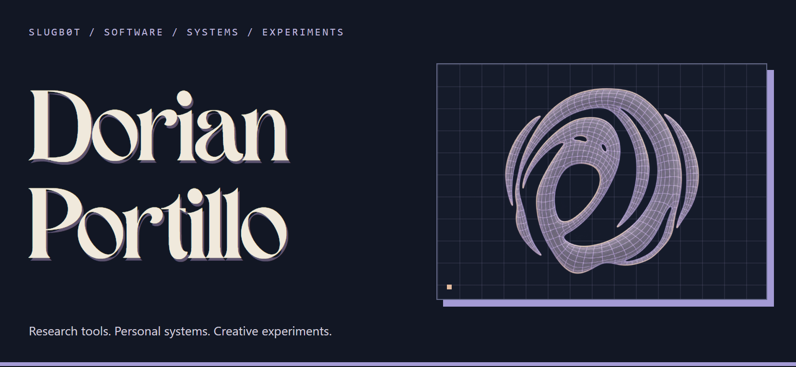
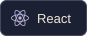
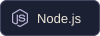

<a href="https://dorianportillo.dev">
  <picture>
    <source media="(max-width: 600px)" srcset="./assets/night-signal-header-mobile.png">
    
  </picture>
</a>

## Hi, I'm Dorian

they/them · @slugb0t

I'm a research software developer at the [FAIR Data Innovations Hub](https://fairdataihub.org). I lead Codefair and build tools for research software reuse, scientific publishing, and biomedical data curation.

My work spans GitHub automation, metadata extraction and validation, and web and desktop applications for researchers. I care about clear documentation, reproducible workflows, and software people can inspect and build on.

## Selected work

- **[Codefair](https://codefair.io) | Project lead** - I lead development of a GitHub App and web platform that helps maintainers improve research software metadata, automate FAIR checks, and archive releases. [Source](https://github.com/fairdataihub/codefair-app) · [Docs](https://docs.codefair.io)
- **[Posters.science](https://posters.science) + [poster2json](https://github.com/fairdataihub/poster2json)** - I work on scientific poster publishing and Python pipelines for structured metadata extraction and schema validation. [Platform source](https://github.com/fairdataihub/posters-science)
- **[SODA for SPARC](https://github.com/fairdataihub/SODA-for-SPARC) | Contributor and JOSS co-author** - I contributed to a desktop application that helps researchers organize, curate, and share biomedical datasets. [Paper](https://doi.org/10.21105/joss.06140)
- **[whispercpp-extras](https://github.com/slugb0t/whispercpp-extras) | Personal project** - Local dictation and transcription tools built around whisper.cpp, with live word correction and a desktop overlay.

## Tools I work with

<!-- toolkit:start -->

**Web and desktop**

  
  
  
  
  
  

**Data and APIs**

  
  
  
  
  
  

**Delivery and infrastructure**

  
  
  
  
  
  
  

Also used across projects

  
  
  

<!-- toolkit:end -->

**Research workflows:** FAIR metadata · JSON Schema / JSON-LD · DOI / DataCite · ROR · SPDX

## Away from the issue tracker

Music, writing, creative coding, and personal interfaces. I care about open science, digital privacy, and making useful software feel personal.
